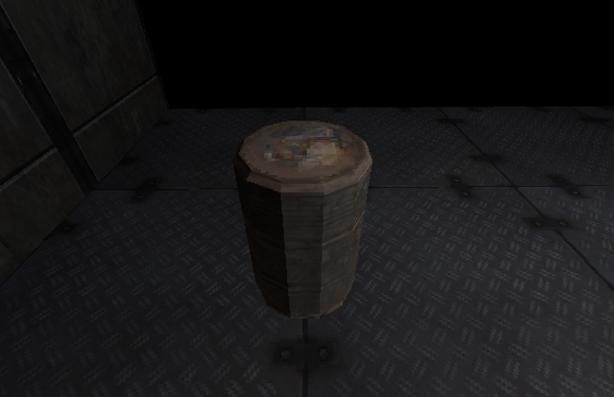

# Electron Game Engine

A first-person 3D desktop game prototype. The application uses Electron as the desktop shell and Three.js for the scene, rendering, and gameplay objects. The sample level includes a room, platforms, obstacles, and an ambient sound object.

<p align="center">
  
</p>

## Requirements

- [Node.js](https://nodejs.org/) (recommended: current LTS version)
- npm (included with Node.js)

## Installation and Startup

From the project directory, install dependencies and build the app:

```sh
npm install
npm run build
npm start
```

`npm start` launches the Electron application and loads the built renderer from `dist/renderer`.

## Development

For a reliable development workflow, run the commands in three separate terminals. Start the Vite server first before launching Electron:

```sh
npm run dev:vite
```

```sh
npm run dev:main
```

```sh
npm run dev:electron
```

The renderer is available through Vite during development. TypeScript rebuilds the Electron main process in watch mode when changes are made.

## Controls

- **W / A / S / D**: move
- **Mouse**: look around
- **Left Ctrl**: crouch
- **Mouse click in the game window**: lock pointer; **Esc** unlocks it again

## Project Structure

```text
assets/             3D models, sounds, and application icons
src/core/           gameplay logic, player, collisions, and input handling
src/electron/       Electron main process
src/renderer/       Three.js scene and renderer entry point
package.json        dependencies and npm scripts
vite.config.ts      Vite configuration for the renderer
tsconfig.json       TypeScript configuration
```

## Available npm Scripts

| Command | Description |
| --- | --- |
| `npm run build` | Builds the Electron main process and renderer |
| `npm start` | Starts the built desktop application |
| `npm run dev:vite` | Starts the Vite development server |
| `npm run dev:main` | Watches and rebuilds the Electron main process |
| `npm run dev:electron` | Starts Electron with the Vite development server |

